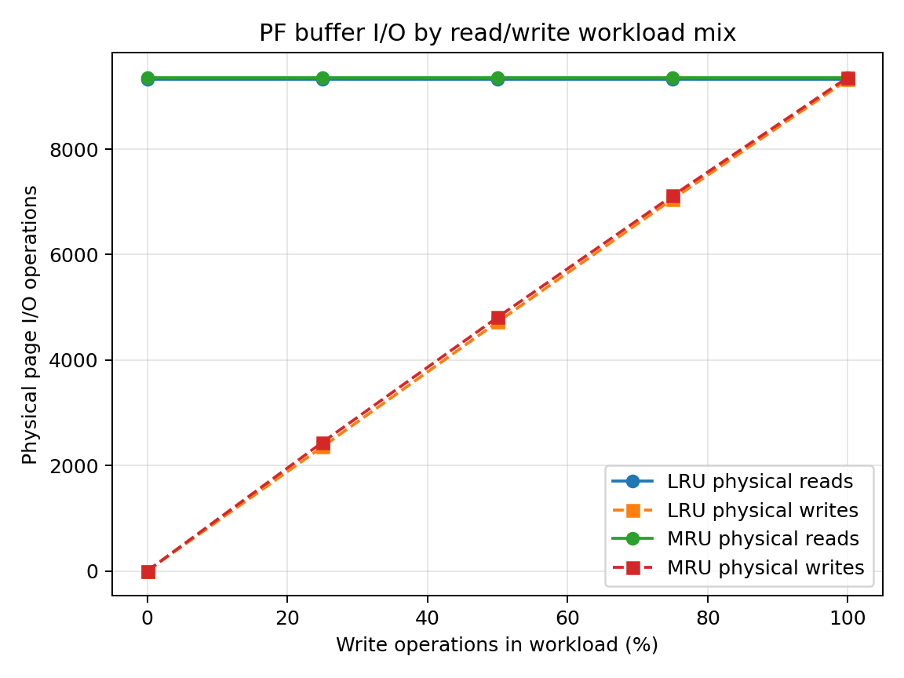
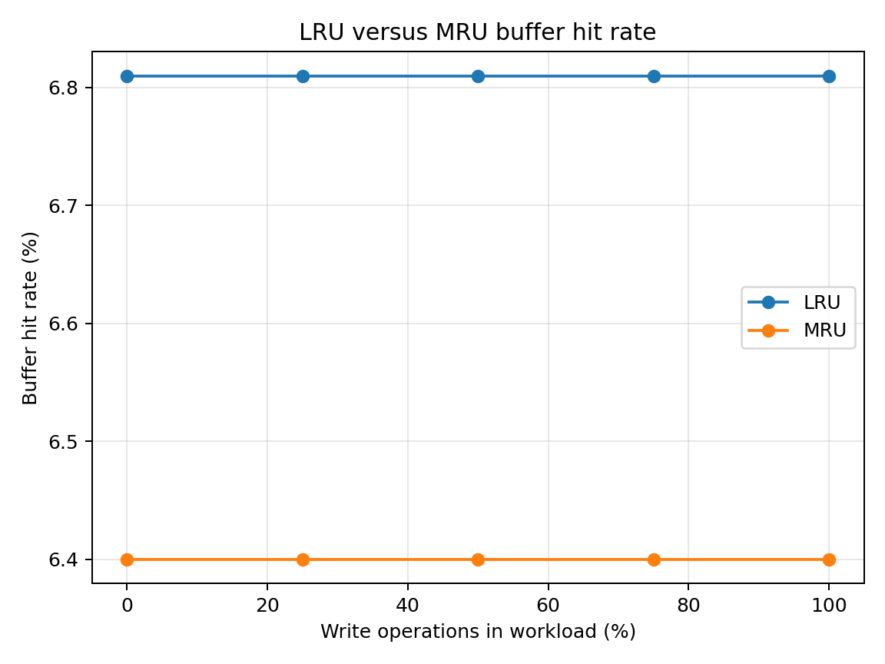
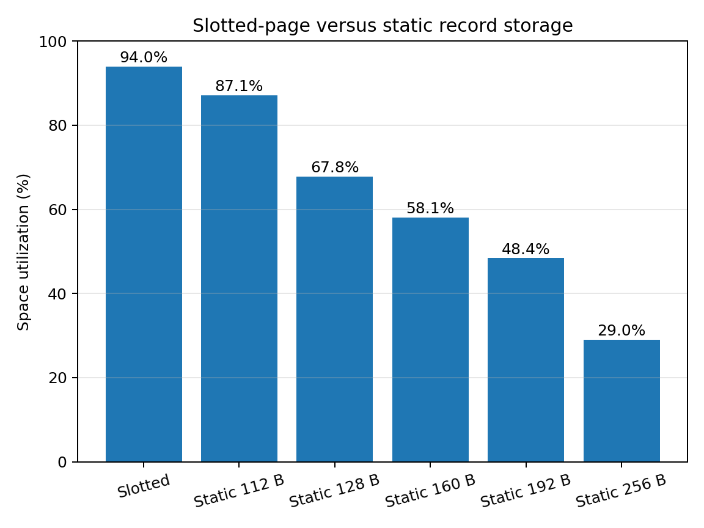
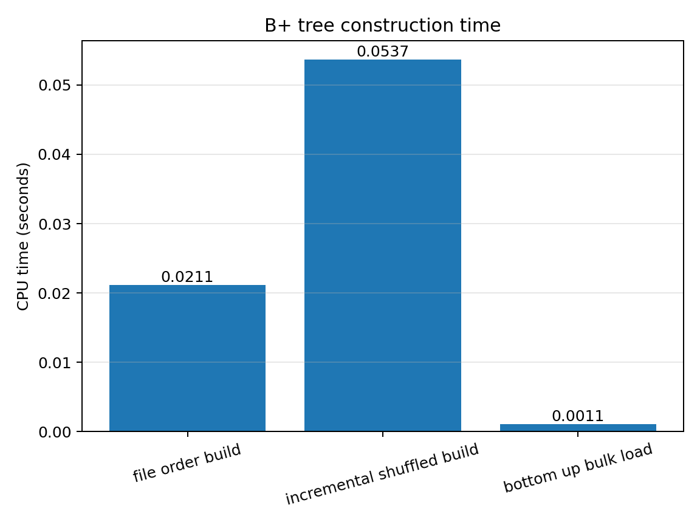
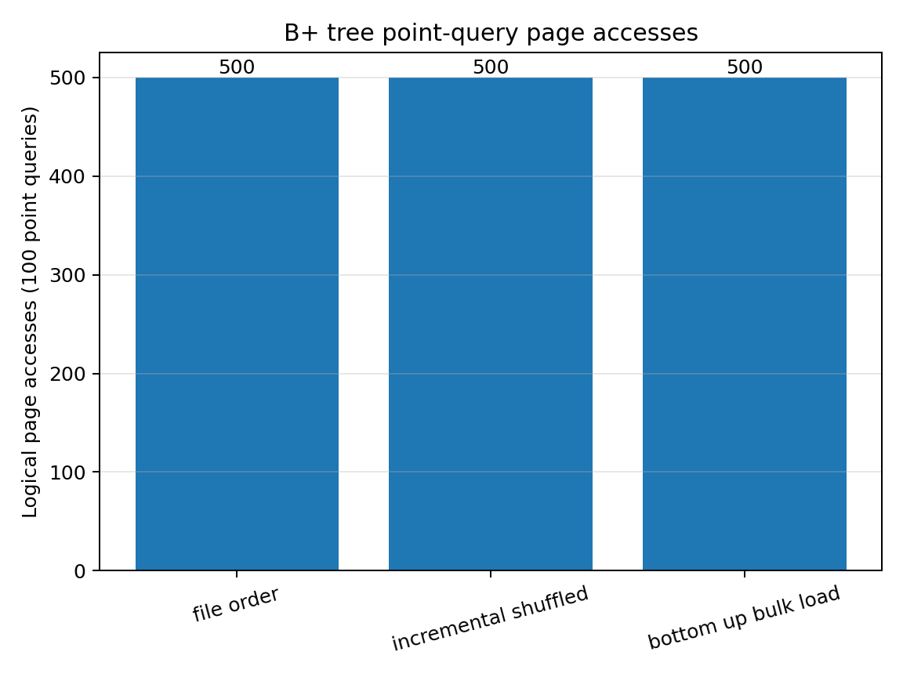

# Assignment 1 — Implementation and Experimental Report

## 1. Overview

The project implements page buffering in the PF layer, a variable-length slotted-page heap file in the HF layer, and Student roll-number indexing in the AM layer. All experiments below were executed against the supplied `data/student.txt` file, which contains 17,813 non-empty Student records after skipping its descriptive first line.

## 2. PF page buffering

The PF buffer pool now supports LRU and MRU replacement, a configurable frame capacity, dirty-page writeback, and statistics for logical reads/writes, physical reads/writes, hits, misses, and evictions. The benchmark uses 128 pages, an 8-frame pool, 10,000 operations per case, and write shares of 0%, 25%, 50%, 75%, and 100%.

| Policy | Write share | Logical reads | Logical writes | Physical reads | Physical writes | Hits |
|---|---:|---:|---:|---:|---:|---:|
| LRU | 0% | 10,000 | 0 | 9,319 | 0 | 681 |
| LRU | 25% | 10,000 | 2,500 | 9,319 | 2,354 | 681 |
| LRU | 50% | 10,000 | 5,000 | 9,319 | 4,721 | 681 |
| LRU | 75% | 10,000 | 7,500 | 9,319 | 7,053 | 681 |
| LRU | 100% | 10,000 | 10,000 | 9,319 | 9,319 | 681 |
| MRU | 0% | 10,000 | 0 | 9,360 | 0 | 640 |
| MRU | 25% | 10,000 | 2,500 | 9,360 | 2,439 | 640 |
| MRU | 50% | 10,000 | 5,000 | 9,360 | 4,810 | 640 |
| MRU | 75% | 10,000 | 7,500 | 9,360 | 7,116 | 640 |
| MRU | 100% | 10,000 | 10,000 | 9,360 | 9,360 | 640 |

For this deterministic random-access workload, LRU produced 41 fewer physical reads than MRU (9,319 versus 9,360) and 41 more cache hits. The difference is small, but LRU is better for this particular access pattern. MRU is included as the requested selectable alternative; sequential workloads can favor MRU when the most recently used page is unlikely to be reused.

## 3. HF slotted-page storage

The HF layer stores each text row as a variable-length record. A page contains a header and slot directory; record bytes are packed from the end of the page. Deletion invalidates the slot, and compaction before a subsequent insertion reclaims fragmented space while preserving the RIDs of live records. The experiment inserted and sequentially scanned all 17,813 records successfully.

| Storage method | Maximum static record length | Pages | Allocated bytes | Space utilization |
|---|---:|---:|---:|---:|
| Slotted page | Variable | 1,921 | 1,959,420 | 94.00% |
| Static | 112 B | 1,980 | 2,019,600 | 87.10% |
| Static | 128 B | 2,545 | 2,595,900 | 67.76% |
| Static | 160 B | 2,969 | 3,028,380 | 58.08% |
| Static | 192 B | 3,563 | 3,634,260 | 48.40% |
| Static | 256 B | 5,938 | 6,056,760 | 29.04% |

The slotted-page representation uses fewer pages than every tested static maximum length and reaches approximately 94% utilization. The static allocation wastes more space as the maximum record length grows beyond the records' average length.

## 4. AM B+ tree indexing

The Student dataset's second semicolon-separated field is an 8-character roll number. It is indexed as a fixed-width character key. The first field is a separate student identifier. The dataset includes repeated roll-number values, so the AM layer's RID overflow chain is used for duplicates. The input row number is used as the record ID for the experiment.

Three construction approaches were measured:

| Method | Build time (s) | Logical page accesses | Physical reads | Physical writes |
|---|---:|---:|---:|---:|
| Existing-file pass (file order) | 0.021132 | 50,492 | 289 | 748 |
| Empty index + shuffled inserts | 0.053679 | 50,172 | 15,156 | 15,085 |
| Bottom-up bulk loading | 0.001056 | 289 | 289 | 583 |

The bottom-up loader sorts the keys, packs the leaf pages including duplicate RID chains, and constructs internal levels from child minimum keys. It is materially faster in this run because it avoids repeated tree searches and split operations during construction.

For 100 deterministic equality lookups:

| Method | Query time (s) | Logical page accesses | Physical reads | Correct lookups |
|---|---:|---:|---:|---:|
| Existing-file pass | 0.003398 | 500 | 98 | 100/100 |
| Empty index + shuffled inserts | 0.003757 | 500 | 115 | 100/100 |
| Bottom-up bulk loading | 0.003359 | 500 | 41 | 100/100 |

The bottom-up index also passed a full sequential scan returning all 17,813 record IDs. Query timings are close because the same tree height and same point-lookup operation are used; the bulk-loaded index incurred fewer physical reads in this run.

## 5. Validation and reproduction

The full project build succeeds with `make`. The automated experiment script `./run_all_experiments.sh` rebuilds the code, runs the PF, HF, and AM benchmarks, writes CSV results, and regenerates the plots. The HF test program additionally checks insertion, retrieval, deletion, deleted-slot rejection, slot reuse after compaction, and sequential scanning.

## 6. Measurement notes

- CPU times are single-run measurements from the execution environment and will vary across systems.
- PF logical writes count dirty-page updates; physical writes count actual dirty-page writebacks on eviction or close.
- The PF benchmark uses a deterministic pseudo-random access sequence; its LRU/MRU ranking should not be generalized to every workload.
- Static-record utilization is calculated using page capacity under the specified fixed record length. Slotted utilization includes the page header and slot directory in used bytes.
- The bulk loader is specialized to this assignment's fixed-width 8-byte character roll-number key and the supplied Student file. It is not a general-purpose bulk loader for every AM key type.
